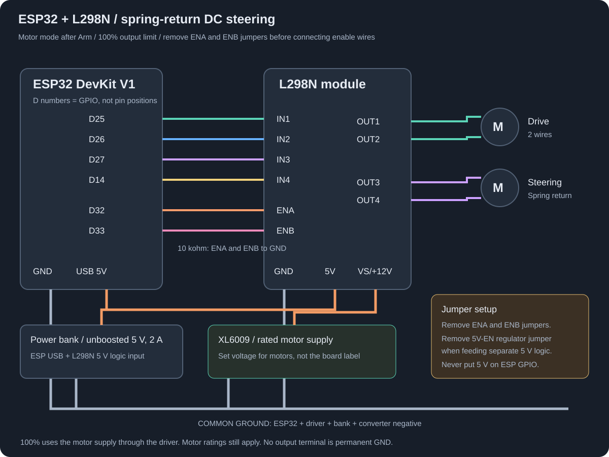

# Local ESP32 car controller

Run **`start.cmd`**, then open **http://localhost:8765**. The page, controller diagnostics, and illustrated wiring guide work without ESP configuration. Desktop mode binds to `127.0.0.1:8765`; optional phone mode also serves HTTPS on this computer's shared Wi-Fi adapter. The ESP hosts a command API, not the site. All assets are local, with no cloud or runtime package dependencies. Optional Quest video uses a separately configured local camera; see [QUEST.md](QUEST.md).

The configured firmware targets **L298N**, enables motor output after a successful neutral arm handshake, and defaults desktop and phone power limits to **100%**. The current local configuration also selects **steering hold**: output follows the wheel/phone request until centred, stopped, or the optional command watchdog expires when enabled. The steering-hold build has been uploaded and its live status verified on this board. It boots stopped and disarmed. At full duty the motors receive the motor supply through the driver's voltage drop; choose the motor supply for the motors' ratings. The terminal marked `+12V` does not mean every motor requires 12 V.

## Command timeout switch

The requested local configuration now sets `COMMAND_TIMEOUT_ENABLED false` in ignored `firmware/car_controller/config.h`. The disabled-timeout firmware has been compiled, uploaded to COM7 and verified through 10 authenticated status checks: `command_timeout_enabled: false`, `command_timeout_ms: 0`. With the command timeout disabled, the last drive/steering output can persist if the computer stops sending commands. Wi-Fi loss, Emergency Stop and invalid commands still stop/disarm. Browser focus/input failures and relay request failures can also send Stop independently.

To reactivate the 400 ms command timeout later, set `COMMAND_TIMEOUT_ENABLED true`, then rebuild and upload. Fresh/example configurations default to enabled. The desktop and phone pages display the timeout mode reported by the actual ESP firmware.

## L298N connections



| ESP32 / component | L298N |
| --- | --- |
| D25 (GPIO25) | IN1 |
| D26 (GPIO26) | IN2 |
| D27 (GPIO27) | IN3 |
| D14 (GPIO14) | IN4 |
| D32 (GPIO32) | ENA, jumper removed |
| D33 (GPIO33) | ENB, jumper removed |
| GND | GND / common negative |
| Drive motor, two wires | OUT1 / OUT2 |
| Spring-return steering motor, two wires | OUT3 / OUT4 |

**With power off, remove ENA and ENB jumpers before attaching the ESP enable wires.** Add 10 kohm from ENA to GND and ENB to GND so the driver stays disabled while the ESP boots or is unplugged. Existing direction-input pull-downs may stay fitted. The firmware uses direction pins plus 20 kHz, 8-bit PWM on ENA/ENB; 100% is duty 255. It disables the bridge before reversing polarity.

Power the ESP through USB from unboosted 5 V. For the common L298N module, remove the separate **5V-EN regulator jumper** and feed regulated, unboosted **5 V into the module's 5V logic terminal**. This regulator jumper is different from the ENA/ENB jumpers. Do not combine an external 5 V feed with an enabled onboard 5 V regulator. Check the board labels/schematic if its regulator arrangement differs. ESP 3.3 V logic is accepted by L298N TTL inputs; never connect 5 V power to an ESP GPIO.

Connect the rated motor supply (XL6009 output if appropriate for the motors) to L298N `VS/+12V`, and its negative to GND. Join ESP GND, L298N GND, bank negative and converter negative. Route motor current directly through the power wiring. Neither motor output wire is permanent ground. Place 100 uF bulk plus 100 nF ceramic capacitance across motor supply/GND close to the driver, with capacitor ratings above the supply voltage. Use a module with its flyback diodes fitted.

The earlier DRV8833-specific 10.8 V restriction does not apply to L298N. However, the motors, module regulator/capacitors, cooling, and available current determine the usable supply. A 5 V / 2 A bank has 10 W shared by the ESP, logic and motor power path; boosting does not create more power. L298N voltage drop and heat can reduce motor performance. See the [ST L298 datasheet](https://www.st.com/resource/en/datasheet/l298.pdf) and [ESP power guidance](https://documentation.espressif.com/esp-dev-kits/en/latest/esp32/esp32-devkitc/user_guide.html).

## Shared Wi-Fi setup

The current configuration joins **Burugupally_5G** using the credentials read from `wifi - Burugupally_5G.txt`. The classic ESP32 uses **2.4 GHz** Wi-Fi. The computer and phone must be on the same router's local network; a 5 GHz band is fine for the computer/phone if the router bridges both bands. Guest/client isolation must be off. The ESP no longer creates ESP-Car in this configuration. Internet is not needed for control.

1. Credentials are stored in ignored `wifi.local.json` and `firmware/car_controller/config.h`. The paired control token stays in the ignored firmware and relay configurations. Do not share those files or firmware binaries. To reconfigure from a labelled credential file, run `python configure_wifi.py "wifi - Burugupally_5G.txt"`; this preserves the paired token, motor-enable setting and steering-hold setting. For a fresh checkout run `python setup.py` first; fresh setup keeps motor output disabled.
2. Compile/upload with `powershell -ExecutionPolicy Bypass -File .\build-firmware.ps1 -Port COM7`, using the current USB port. Arduino IDE also works: DOIT ESP32 DEVKIT V1, ESP32 core 3.x, ArduinoJson 7.4.3. If automatic bootloader entry fails, hold BOOT, tap EN/RESET, start upload, then release BOOT when writing begins. Keep motor power off while uploading.
3. After boot the ESP joins the router and gets an address by DHCP. Serial Monitor at 115200 baud prints the network name and ESP address without passwords/tokens. Its hostname is `esp-car.local`.
4. Run `start.cmd` for desktop or `start-mobile.cmd` for phone access. The launcher tries the last paired address, the local hostname, then nonce-based UDP discovery on port 8769. Each discovered address must pass a token-authenticated status request before use. Discovery never arms or drives. The paired address is saved in `relay.local.json`. Restart the launcher after an address change; commands are never replayed.
5. The control website stays on the computer at **http://localhost:8765**. The ESP serves only its command API. Direct `python server.py` uses the last saved ESP address; the Windows launchers perform discovery first.
6. The configured L298N firmware enables motor output after **Arm** and boots stopped/disarmed. Both power presets remain **100%**. Test with wheels raised. Loss of the ESP's router connection disarms independently of HTTP; loss of commands is covered by the 400 ms timeout when enabled. With it disabled, the last output can persist. Desktop wheel mode can auto-arm after reconnection only with valid, neutral inputs and no manual pause; phone mode needs explicit Arm.

The source retains optional hotspot support for fresh `setup.py` configurations, but `configure_wifi.py` selects station-only mode. Rebuild and upload after changing network credentials. The old `hotspot.local.json` is no longer used by the current shared-Wi-Fi firmware. No router port forwarding is needed.

## Wi-Fi IP address mismatch

Optional idle keepalive: `python idle_keepalive.py` checks the local relay once per second even without wheel/keyboard input. It sends only GET status requests, does not arm or take ownership, and cannot refresh the ESP's optional 400 ms motor-command watchdog. The relay must stay running. Background state is recorded in ignored `artifacts/idle-keepalive.json`; stop a background instance with `powershell -ExecutionPolicy Bypass -File .\stop-keepalive.ps1`.

The current network is **Burugupally_5G**. On 25 October 2026, the ESP received **10.221.246.3** and this computer received **10.221.246.224**. The ESP address is saved locally after authenticated discovery; DHCP can change these addresses later.

This computer previously had a fixed `192.168.58.22` address with DHCP disabled, preventing access to the new network. Wi-Fi 2 was restored to automatic IPv4 addressing using Windows administrator approval. The previous settings are saved in ignored `artifacts/wifi-ip-before-dhcp-2026-10-25.json`. The prepared `enable-wifi-dhcp.ps1` helper is restricted to this computer's verified Wi-Fi adapter and requires Administrator rights; use it only when restoring automatic addressing is needed.

## Phone tilt controller

1. Connect **the ESP, computer and phone to the same local Wi-Fi network**. The current ESP configuration uses **Burugupally_5G**. Keep the computer running: it hosts the page and relays commands.
2. Close any existing `start.cmd` server window, then double-click **`start-mobile.cmd`**. It discovers the paired ESP and detects the computer's Wi-Fi IP, prepares local HTTPS, and prints a **Phone setup** URL and **Phone controller** URL. For example, if the computer receives `10.221.246.224`, they are `http://10.221.246.224:8768` and `https://10.221.246.224:8767/phone`. Use the printed computer address, not the ESP address.
3. Open the printed **Phone setup** URL on the phone. Download and trust this computer's local CA once, following the page's iPhone/Android instructions. Then open the printed HTTPS controller URL. Motion sensors require a secure context and browser permission ([W3C Motion API](https://www.w3.org/TR/orientation-event/)). A certificate-warning bypass is not a replacement for installing/trusting the generated CA.
4. Tap **Enable tilt**, grant motion permission, hold the phone comfortably, then **Set centre** and **Arm**. Tilt left/right to steer. Hold the **right half to accelerate**, **left half to reverse**. Lifting your finger zeros both motor requests without requiring another Arm. A centre dead zone reduces hand jitter; full steering is reached at about 30 degrees from the calibrated centre.
5. Both halves pressed together, interrupted/lost touch, moving outside a button, stale sensors, screen rotation, page hiding, loss of focus, or connection failure disarm. Screen rotation requires centre calibration again. Drive power limit defaults to 100% and scales forward/reverse throttle only; steering keeps its full calibrated range; changing it or reversing tilt direction disarms. With the current steering-hold firmware, steering stays powered while held off-centre and fresh commands continue. Return to centre to release the spring. Fresh/example configurations retain the optional 250 ms pulse mode.

If Windows Firewall blocks the phone, open **Administrator PowerShell** in this folder and run `powershell -ExecutionPolicy Bypass -File .\enable-phone-access.ps1`. This allows Python ports **8767/8768 only on the computer's Wi-Fi address**, only from **the local subnet**. It does not expose the desktop HTTP port. No firewall or certificate-trust setting is changed automatically. To remove the rule later, use `Remove-NetFirewallRule -Name ESPCarPhoneController` in Administrator PowerShell.

The local CA/private keys are in ignored `.mobile/`. Only its public certificate is downloadable through the setup server; keys and Wi-Fi/token configuration files are never served. The CA is not installed on this computer by the helper. Protect its private key and remove the trusted CA from the phone when no longer using this controller. Phone instructions: [Apple certificate trust](https://support.apple.com/en-us/102390), [Android certificate installation](https://support.google.com/pixelphone/answer/2844832).

Desktop controls remain at **http://localhost:8765** in phone mode. Only one controller can be armed at once. A passive/unarmed page does not send Stop on load, focus changes, status failure or close. The owning page stops when hidden, unfocused or left; explicit Emergency Stop works from any driving page. Read-only status polling does not cancel another controller's session. For an on-computer preview of the touch layout, use `http://localhost:8765/phone`; real tilt needs a phone with motion sensors.

## Driving behavior

- Desktop wheel mode auto-arms by default once the ESP and selected wheel are connected, the driving page is focused, mappings are valid, and steering/pedals/Button 0 remain neutral/released for 500 ms. It never replays previous commands: every arm obtains a new session.
- Wheel **Button 0**: disarm/pause while armed or waiting; press again to resume. A manual pause survives reconnection and page reload in this tab. Emergency Stop and calibration/settings changes also pause automatic arming until Button 0 or the on-screen Arm button resumes it. Button 0 stays reserved from other mappings.
- Lost/stale input, hidden/unfocused pages, and Wi-Fi loss still stop the car. When automatic mode is not manually paused, desktop wheel controls may resume only after the connection and neutral-input checks pass again. Keyboard and phone mode retain explicit arming.
- W/S: forward/reverse. A/D: steering. Space: emergency stop and disarm. Focused form controls do not capture driving keys.
- Wheel/gamepad: use **Set up accelerator** or **Set up brake** in Live input with motor power off. Release both pedals and save released; hold only that pedal fully down and save fully pressed; select the detected input and choose Use this pedal. This saves the binding and both endpoints, including inverted axes and analog buttons, while preserving other calibration. Setup keeps auto-arm paused until an explicit Arm / Button 0 resume. Live pedal status identifies an unassigned/unavailable accelerator, invalid travel, or a fully pressed brake cancelling throttle. Manual input selection and endpoint capture remain available. Selecting a steering input automatically enables wheel mode and resets only steering calibration. Its live raw/calibrated values are displayed next to the mapping; Reset steering calibration repairs old unusable captures while preserving pedals. Steering dead zone is relative to calibrated travel, including small-range axes. Test under `/test`. A supported controller can provide one 200 ms brake vibration burst per press.
- Release pedals and centre steering to arm. Changing mappings, selected controller/source, output limit, or reverse selection disarms. Missing mapped inputs prevent arming.
- Desktop drive commands read the current wheel/gamepad directly on each control tick. Delayed preview animation does not expire a valid held steering input. The **Last disarm** line preserves the most recent active stop reason across reconnection/reload in this tab, so Button 0, mapped stop/reverse, focus/controller loss and network failures can be distinguished.
- Brake mode cancels throttle; reverse pedal mode requests negative throttle. ENA/ENB low means **coast**, not an active mechanical brake.
- The page displays requested steering, not a measured wheel angle. In the configured **hold** mode, spring-return DC steering stays energized at the requested PWM while fresh commands continue; centre input releases it. This is motor torque, not measured-angle positioning. A motor held against its end stop draws stall current: verify its rated supply, continuous holding/stall current and temperature before sustained turns. The optional default/example **pulse** mode still limits activation to 250 ms per excursion and requires neutral before another pulse.
- Fresh requests are sent every **50 ms** while armed, one outstanding at a time. Input samples older than 120 ms are rejected. The relay never stores a command queue or independently repeats a command.
- The ESP’s independent 5 ms motor task stops/disarms at **400 ms** without valid commands or on Wi-Fi loss. The effective physical deadline also includes task scheduling. Reboot, invalid session/sequence/input, Emergency Stop, page hiding, focus loss, or controller loss stop the motors; desktop auto-resume still requires valid neutral inputs and no manual pause.
- The firmware defaults to motor output disabled even when no `config.h` exists. An unconfigured fallback halts network startup and cannot drive. Compile success is not physical wiring verification.

## API and architecture

On the phone, the Arm readiness hint identifies missing motion permission/data, missing centre calibration, held drive buttons, an off-centre phone, an unavailable ESP or another controller's ownership. Normal background status checks do not disable the Arm button. An Arm tap can wait up to 1.5 seconds for the current status/Stop request to finish, then rechecks fresh neutral input before sending a new arm handshake. Stop, focus loss and recalibration cancel that pending tap; drive commands are never queued or replayed.

Browser → local Python relay → ESP32 HTTP API on port 80. APIs: `GET /api/status`, `POST /api/arm`, `POST /api/control`, `POST /api/stop`. The relay forwards `X-Control-Token`; the browser never receives it. Cross-origin and invalid Host requests to the relay are rejected.

Each controller/setup listener reserves its address and port exclusively. A second relay fails to start instead of competing for incoming requests and keeping a separate ownership/session state. On Windows this uses [`SO_EXCLUSIVEADDRUSE`](https://learn.microsoft.com/en-us/windows/win32/winsock/using-so-reuseaddr-and-so-exclusiveaddruse), with address/port reuse disabled.

Idle status checks allow 500 ms for a response and share successful snapshots for 500 ms. Failed status probes have a shared one-second backoff so multiple tabs and the idle keepalive cannot flood an unreachable device. Armed status reads and motor commands retain the configured short timeout. These read-only checks never refresh motor-command freshness or extend the optional independent 400 ms ESP watchdog.

Arming requires `{owner, throttle, steering, neutral:true}`. The relay obtains the current ESP `arm_nonce` and forwards it; the nonce changes on stop, expiry, reboot, and accepted arm. The ESP returns a random `session`. Controls carry `{owner, session, seq, throttle, steering}`; seq strictly increases within the session, values are finite numbers in [-1,1]. Old sessions/sequence numbers cannot resume output. Stop is unconditional for any authenticated caller. Status includes requested values, actual PWM requests (`drive_output`, `steering_output`), `output_enabled`, `steering_mode` (`hold` or `pulse`) and motor mode. The relay cancels in-flight arming across stops, drops concurrent non-stop requests, and invalidates local sessions on command errors. A read-only status failure does not cancel the owning controller. Drive commands are never retried or replayed. Desktop wheel auto-arm is a new neutral-gated session with a two-second retry backoff; another active owner is never displaced.

## Validation

```powershell
python -m unittest discover -s tests -p 'test_*.py' -v
node tests/test_auto_arm.js
node tests/test_arm_button.js
node tests/test_mapping.js
node tests/test_calibration.js
node tests/test_simulation.js
node tests/test_brake_rumble.js
node tests/test_control_session.js
node tests/test_phone_input.js
```

The pure C++ `SafetyCore.h` is tested natively by `tests/test_safety.cpp`; `tests/test_native.ps1` finds the installed Visual Studio C++ compiler. Firmware build and browser QA instructions/results are in `VALIDATION.md`.

Before ground driving, physically verify forward/reverse, steering hold/centre return, Emergency Stop, Wi-Fi loss, controller unplugging, and relay/computer shutdown. Check startup current and power-bank shutdown under load. Firmware flashing and physical tests require the actual board and confirmed motor supply.
## Quest 2 cockpit

Run `start-quest.cmd`, then open the printed HTTPS `/quest` address in Meta Quest Browser. Practice works now without a camera or connected ESP and sends no motor commands. Live car uses Touch controls and requires video; a phone can publish from `/camera`. A separately flashed AI Thinker ESP32-CAM companion is prepared for automatic pairing/reconnect, including IP changes. Other Wi-Fi cameras remember a JPEG/MJPEG address entered once and retry automatically. See [QUEST.md](QUEST.md) for controls, phone instructions, one-time camera setup, HTTPS and verification limits. The existing motor firmware and command-timeout setting are preserved.


## Car battery display

Desktop, phone and Quest setup pages display car battery telemetry from the motor ESP's existing status/control responses. Refresh the page to load the indicator. No additional requests or motor commands are sent for battery monitoring.

The current firmware and wiring do not include a battery sensor, so the indicator shows **Unavailable**. Powering the ESP from a USB power bank does not provide a battery reading in this project's API. Actual charge needs a fuel gauge or a battery monitor connected to the ESP; its implementation depends on the battery type and sensor. Do not connect battery power directly to a GPIO.

The display accepts an optional status object `"battery": {"percent": 72, "voltage": 3.91}`. `percent` must be a number from 0 to 100; `voltage` must be a positive number in volts. Either may be omitted. Voltage alone is displayed in volts and never converted to an invented charge estimate. Missing, invalid, `available: false`, or `fresh: false` readings show Unavailable; disconnects clear the displayed reading. In the two-board profile the reading belongs to the motor ESP, not the camera S3.
